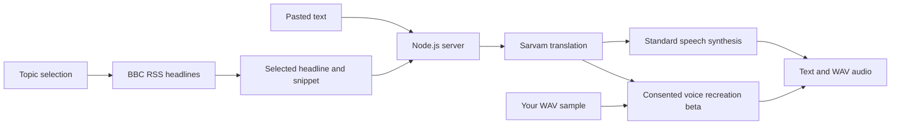

# Suno News Mirror

### Your world. Your language. A voice like yours.

**Hosted app:** [Open Suno News Mirror](https://suno-news-mirror-iitb.sacredjam128.chatgpt.site) — public access; no sign-in required.

**A multilingual listening companion built for Sarvam Campus '26 at IIT Bombay.**

Suno turns current headlines and everyday text into spoken audio. Choose a topic, pick your listening language, and hear a personal news edition powered by Sarvam AI. Optional, consent-based voice recreation adds a familiar voice to the experience.

[Quick start](#quick-start) · [Demo guide](docs/NEWS-DEMO.md) · [Validation](docs/VALIDATION.md) · [Deployment & hosting source](docs/DEPLOYMENT.md) · [Project plan](PLAN.md)

---

## Features

| Mode | Input | Result |
| --- | --- | --- |
| **News Mirror** | Choose India, World, Technology, Science or Business | Up to five mixed-publisher RSS headlines, prioritizing Indian sources, with original links and publication times |
| **Listen in my language** | Select a headline and listening language | Translated text and playable WAV narration |
| **Own-voice beta** | Prepare a headline, supply your WAV and confirm consent | An AI voice recreation reading the prepared text |
| **Text Reader** | Paste a notice, study paragraph or message | Readable text and standard-voice audio, with playback speed and download controls |

**11 listening languages:** English, Hindi, Bengali, Gujarati, Kannada, Malayalam, Marathi, Odia, Punjabi, Tamil and Telugu.

Larger text, high contrast, keyboard focus indicators and native audio controls support different reading preferences. Accessibility has not been formally audited.

## Quick start

Requires **Node.js 22+**, internet access and a **Sarvam API key**. No npm dependencies are required.

```bash
git clone https://github.com/tanishjain0911-beep/sarvam-campus-26-iitb.git
cd sarvam-campus-26-iitb
```

Copy `.env.example` to `.env`, enter your key in a local editor, then start:

```bash
node --env-file=.env server.mjs
```

Open **http://127.0.0.1:3000**. If `SARVAM_API_KEY` is already set in your environment, use `npm start`.

**Windows launcher:** `Start-Suno.cmd` or `node scripts/start-local.mjs` reads an existing `~/.sarvam/credentials` file without printing the key. Set `PORT` to change the port; `HOST` defaults to loopback.

## Demo walkthrough

1. Open **News Mirror** and choose a topic.
2. Choose a listening language, then **Listen in my language** on a headline.
3. Wait for generation, then **press Play** on the audio player.
4. For the own-voice beta, record 12 seconds or upload a clean WAV, confirm consent, then choose **Read in my voice**. Press Play when ready.
5. Switch to **Text Reader** for standard-voice narration of pasted text.

Use a clean, single-speaker WAV between **1 and 15 seconds**, at most **10 MB**; 10–15 seconds is recommended. Selecting or recording a sample alone does not upload it. The explicit clone action sends it to Sarvam after consent.

> **Prototype status:** Own-voice recreation is experimental; likeness, accent and expression vary. The Text Reader currently uses a standard voice; a sample uploaded in News Mirror does not change its voice. A reported own-voice playback/flow issue remains under investigation. See the [validation record](docs/VALIDATION.md) for tested paths and limitations.

## Architecture



| Component | Implementation |
| --- | --- |
| Frontend | HTML, CSS and vanilla JavaScript |
| Server | Native Node.js HTTP server |
| Translation | Sarvam `mayura:v1`, formal mode |
| Standard speech | Sarvam `bulbul:v3`, `shubh`, 24 kHz WAV |
| Voice recreation | Sarvam `/voices/clone`, consent-gated multipart WAV |
| News | The Indian Express, The Hindu, Hindustan Times and BBC RSS; 60-second cache and visible-page polling |
| Tests | Node.js built-in test runner with mocked provider responses |

See [news sources and feed behavior](docs/NEWS-SOURCES.md) for publisher coverage and resilience.

## Privacy and boundaries

- API keys stay on the server. `.env`, credentials and recordings are excluded from Git.
- Generation sends text to Sarvam and may consume credits. Voice recreation additionally sends the consented recording.
- Suno does not save a voice profile or text/audio history on its server; provider data policies apply.
- Only appearance preferences are saved locally. There are no accounts or analytics.
- News uses sourced headlines and snippets, with original links. Full articles are not scraped.
- A one-minute refresh checks the feed; it does not guarantee new reporting every minute.
- Personalization means topic and language selection. There is no learned recommendation engine or exact voice, tone or accent guarantee.

## Development and verification

```bash
npm test
node --check server.mjs
node --check public/app.js
node --check public/news.js
node --check public/voice-recorder.js
```

The local Node application has **43 tests**, and the hosted adapter adds **24 tests** (67 total when run from the repository root). The tests cover input validation, consent, WAV validation, feeds, routes, provider failures and timeouts. Tests use mocks and do not spend credits. A real news-to-Hindi standard narration was decoded in the browser; this does not establish own-voice similarity or quality across every language.

This hackathon prototype is deployed publicly on Sites hosting. The Sarvam key is configured as a hosted runtime secret. Production hardening still needs rate limiting, abuse prevention and broader testing. See [deployment notes](docs/DEPLOYMENT.md).

## Repository guide

```text
public/       Interface, audio playback and local WAV recorder
lib/          Sarvam integration, news feeds and voice recreation
tests/        Mocked unit and HTTP route tests
scripts/      Local startup and developer helpers
hosting/      Complete deployed source snapshot, build scripts and lockfile
docs/         Demo guides, validation and coordination records
server.mjs    API routes and static server
```

Built with Codex, OpenCode and Antigravity for **Sarvam Campus '26 × IIT Bombay**. Development handoffs are documented in `docs/`.
